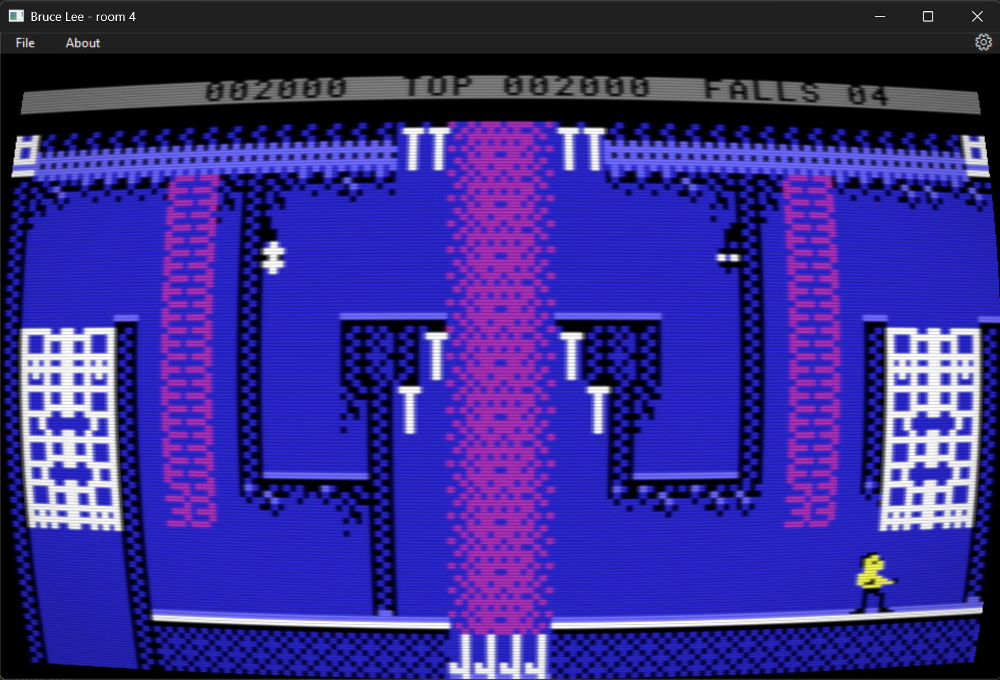

# Bruce Lee

This project recreates the original *Bruce Lee* on the Commodore 64, written natively for Windows with no emulator. It is a homage to the original game and a way to preserve it for the future in source format.

No copyright is claimed over the original game, its pictures, sound, room data, manual, disk image, or box art, and those files are not relicensed by this grant. The Commodore 64 game is copyright 1984 Datasoft, Inc. It was made by Ron J. Fortier, with graphics by Kelly Day and music by John A. Fitzpatrick. This Windows port is copyright Jacob Marner.

This is still a work in progress. 

Latest release: (https://github.com/kingbee88/BruceLeeRemake/releases/download/v0.2-alpha/BruceLeeRemakev0.2.zip)

## Overview

The game is a C++ rewrite of the original game. Pictures, the room layout, and the collision test come from the original bytes in `data/`. A Windows window, drawn with Direct2D, shows a 320 by 200 screen scaled up with nearest-neighbor filtering. `ShowCRTFilter` draws that same picture as a old school television. Nothing is running inside a Commodore 64 emulator.

The `referencematerial/` contains a copy of the C64 floppy disk image, and a disassembly version of that game (that I comment as I understand the code), and top of that is VICE snapshots from each room. None of the content in this folder are part of the build. It is purely they to help me understand the original game.

| Key | Action |
| --- | --- |
| Space or Enter | Leave the title picture |
| F3 | On the options page, switch 1 player / 2 players |
| F5 | On the options page, switch computer / opponent |
| F7 | Leave the options page |
| Left / Right | Player 1 walks. On player 2's turn as Bruce, with Opponent selected, these move Yamo |
| Up | Player 1 jumps. With Left or Right held, jump sideways |
| Down | Player 1 ducks. On a ladder, climb down |
| Right Ctrl | Player 1 punches while standing. Flying kick while moving |
| W A S D | Player 2. On that player's turn these move Bruce. While player 1 is Bruce and the options page is set to Opponent, they move Yamo. W is up, A is left, S is down, and D is right |
| Left Ctrl | Player 2 punches while standing. Flying kick while moving |
| Space | Pause during play. Press again to resume |
| V | Show the credit line on the top bar, BRUCE LEE (C) 1984 DATASOFT REV.2 BY RJF. Press again for the black bar. Entering a room brings the black bar back |
| S | During play, switch the options tune off or on. Nothing changes until the next options page: it is silent, or the tune starts as soon as that page opens. Press again to switch it back |
| F1 | Return to the options page. The score, the falls, and the rooms start over. The two option choices stay |
| Escape | Leave full screen, and close Settings if it is open |
| F2 | Open the game manual |
| Ctrl+F1 | About |
| Ctrl+, | Settings |
| F12 | Save a picture of the window as the next free ScreenShotXX.png, in the folder the config file was read from. A camera flash shows in the upper right |
| Alt+F4 | Exit |

Double-click anywhere in the window to toggle a borderless full screen. The maximize button turns it on. The Settings window does the same, and Escape leaves full screen. The display mode stays as it is. `FullScreen=True` in the settings file, or on the command line, starts in that mode. Beside the exe, then one folder up, then two folders up, `config.local.ini` is used when that file is there, and otherwise `config.ini`. The program writes the settings back to the file it opened when it closes.

An Xbox pad, or any other XInput controller, does the same things. Settings chooses a controller for each player. Player 1 starts on the first connected controller, and player 2 on the second. F3 on the options page selects two players. They take turns as Bruce. A lost life hands Bruce to the other player, and that player's score, falls, and rooms stay his. The line shows 1UP or 2UP for whoever is Bruce. F5 still chooses the computer or a human Yamo. The human Yamo is whichever stick is not Bruce: player 2 while player 1 is Bruce, and player 1 while player 2 is Bruce. Either controller's A button leaves the title and the options page, and either Menu, View, or Y button does what that row says. The keyboard keeps working while a pad is connected.

| Xbox control | Action |
| --- | --- |
| A | Leave the title picture. Leave the options page. Punch while standing. Flying kick while moving |
| D-pad or left stick | Move. Left and right walk, up jumps, down ducks or climbs |
| D-pad or left stick, up with left or right | Jump sideways |
| Menu | Pause. Press again to resume |
| View | Open Settings. Press again to close it |
| Y | While paused, hold for 2 seconds to return to the options page. A bar under PAUSED fills while Y is held |

`build.bat` compiles with the Visual Studio C++ tools. `build.bat debug` writes `build\Debug\BruceLee.exe` with optimizations off and a program database beside it. `build.bat release`, or `build.bat` with no argument, writes the optimized `build\Release\BruceLee.exe`. `build.bat all` builds both. In Cursor, with the CodeLLDB extension installed, Ctrl+Shift+B builds Debug and F5 launches it under the debugger. The Run and Debug menu can start Release as well.

`DESIGN.md` describes how a frame runs, how the character cells and sprite poses are stored, and how collision decides wall and floor.

## Scoring rules

| Event | Points |
| --- | --- |
| Chopping Ninja or Yamo | 100 |
| Kicking ninja or Yamo | 75 |
| Landing on a fighter | 50 |
| Knocking out the ninja | 200 |
| Knocking out Yamo | 450 |
| Lantern | 125 |
| First time into a room, except room 0 | 2000 |
| Each height band in room 13 | 500 |
| Destroying the wizard | 3000 |

Room 0 never pays. After the treasure room, the other rooms pay 2000 again on the next visit. An extra life is given at 40,000, then every 30,000. The same life counter is what room 16's symbol increments. Past 99 lives the line shows A0, B0, and so on through F9. At 1,000,000 the six digits show 000000 and the total keeps going.

The original game has a bug in a landing that drives the health byte negative. It does not stop at one 50 and one knockout. The game keeps applying that landing until the byte is positive again, so the ninja on 4 health pays 6,550 and is left at 125, and Yamo pays 13,050. A landing that does not cross zero pays 50 once. Set FixBugsInOriginal option to True to fix this. Set it to False to get original scoring.

## Trivia 

Room 16 has a ying-yang symbol. Picking it up with add an extra life. It will reappear if you leave the room and re-enter. You can get up to 5 extra lives this way. Each player has his own counter. It does not reset when completing the game, so it is 5 lives max for that player for the session.

After completing the game, you will restart in room 0 again. After you complete the game the following will change:
* The Room 13 electric floors moves differently.
* The time to spawn for Ninja and Yamo is reduced.

## Current state

* All 20 room added and feature complete
* All animation of Bruce, Yamo and Ninja and their behaviors are in.
* Gamepad support
* Scoring complete - added option to correct a fix in the original scoring.
* Game over screen
* Full screen support
* Infinite Lives and Invulnerability support
* Two players, taking turns as Bruce against the computer or a human Yamo
* Original sound: the effects during play, and the tune on the options page
* CRT filter, from ShowCRTFilter. Curve, scanlines, blur, and vignette can each be turned off

## TODO before v1.0

* Bug fixing

## TODO after v1.0

* Convert assets to something easier to edit.
* Load/save game state
* Record/Replay gameplay - set gamespeed
* A level editor
* Option to play with improved graphics/audio