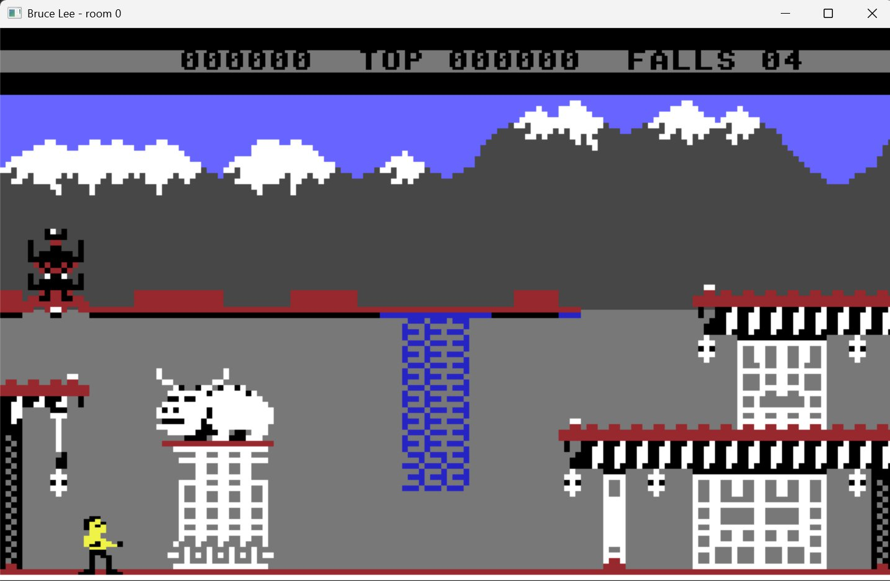

# Bruce Lee

This project recreates the original *Bruce Lee* on the Commodore 64, written natively for Windows with no emulator. It is a homage to the original game and a way to preserve it for the future in source format.

This is still a work in progress. 

Latest release: (https://github.com/kingbee88/BruceLeeRemake/releases/download/v0.1-alpha/release0.1.zip)

## Overview

The game is a C++ rewrite of the original game. Pictures, the room layout, and the collision test come from the original bytes in `data/`. A Windows window, drawn with Direct2D, shows a 320 by 200 screen scaled up with nearest-neighbor filtering. Nothing is running inside a Commodore 64 emulator.

The `referencematerial/` contains a copy of the C64 floppy disk image, and a commented disassembly version of the game, and top of that is VICE snapshots from each room. None of the content in this folder are part of the build. It is purely they to help me understand the original game.

| Key | Action |
| --- | --- |
| Space or Enter | Leave the title picture |
| F3 | On the options page, switch 1 player / 2 players |
| F5 | On the options page, switch computer / opponent |
| F7 | Leave the options page |
| Left / Right | Walk |
| Up | Jump. With Left or Right held, jump sideways |
| Down | Duck. On a ladder, climb down |
| Space | Punch while standing. Flying kick while moving |
| Escape | Close the window |

An Xbox pad, or any other XInput controller, does the same things. The keyboard keeps working while a pad is connected.

| Xbox control | Action |
| --- | --- |
| A | Leave the title picture. Leave the options page. Punch while standing. Flying kick while moving |
| D-pad or left stick | Move. Left and right walk, up jumps, down ducks or climbs |
| D-pad or left stick, up with left or right | Jump sideways |

`build.bat` compiles with the Visual Studio C++ tools. `build.bat debug` writes `build\Debug\BruceLee.exe` with optimizations off and a program database beside it. `build.bat release`, or `build.bat` with no argument, writes the optimized `build\Release\BruceLee.exe`. `build.bat all` builds both. In Cursor, with the CodeLLDB extension installed, Ctrl+Shift+B builds Debug and F5 launches it under the debugger. The Run and Debug menu can start Release as well.

`DESIGN.md` describes how a frame runs, how the character cells and sprite poses are stored, and how collision decides wall and floor.

## Current state

* All 20 room added - most rooms are playable and has lamps, beams, doors, etc. working
* All Bruce movement and fighting animations added and he can move as in original. 
* Gamepad support
* Prove the game is completable

## TODO

* Add Ninja and Yamo and health
* Game over screen
* Fullscreen support
* Trainers
* Audio
* Scoring
* 2 player support
* CRT filtering

## Stretch goals

* Load/save game state
* A level editor
* Option to play with improved graphics